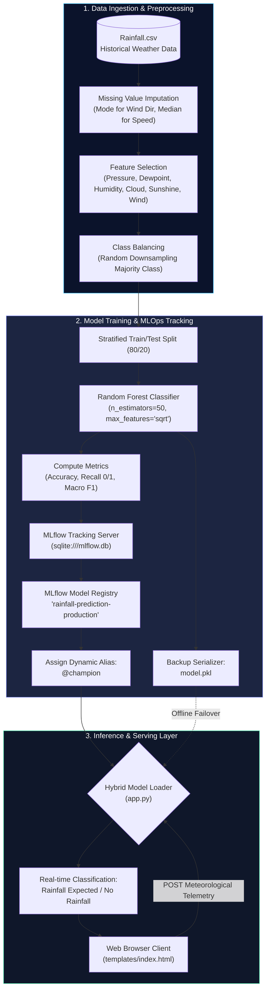

<div align="center">

# 🌧️ Atmospheric Rainfall Prediction & MLOps Platform
### *End-to-End Meteorological Forecasting with Random Forest, Flask & MLflow Model Registry*

[](https://github.com/gurusai95155/RainFall-Prediction/stargazers)
[](https://github.com/gurusai95155/RainFall-Prediction/network/members)
[](https://www.python.org/)
[](https://mlflow.org/)
[](https://flask.palletsprojects.com/)
[](https://scikit-learn.org/)
[](LICENSE)
[](https://github.com/gurusai95155/RainFall-Prediction/pulls)

<br/>

[Overview](#-overview) •
[Key Features](#-key-features) •
[Architecture](#-end-to-end-architecture) •
[Web Interface](#-modern-web-dashboard) •
[Quickstart](#-quickstart-guide) •
[MLflow MLOps](#-mlops--mlflow-tracking) •
[Telemetry & API](#-meteorological-features--api) •
[Troubleshooting](#-troubleshooting--faq)

---

</div>

## 📌 Overview

The **Atmospheric Rainfall Prediction System** is a complete, production-grade Machine Learning and MLOps solution designed to classify and forecast precipitation probabilities from real-time meteorological observations.

By analyzing multi-dimensional atmospheric telemetry—such as atmospheric pressure, dew point, humidity, cloud cover, sunshine duration, and wind velocity—the system delivers highly accurate predictions to aid in **agricultural scheduling**, **water resource management**, **flood risk mitigation**, and **urban resilience planning**.

Integrated with **MLflow**, the platform captures end-to-end experiment lineage, automated model versioning, hyperparameter logging, metric evaluation curves, and dynamic alias routing (`@champion`), backed by a resilient fallback architecture and a modern **Glassmorphism Web Dashboard**.

---

## ✨ Key Features

<table>
  <tr>
    <td width="50%">
      <h3>🤖 Intelligent Ensemble Learning</h3>
      <ul>
        <li>Optimized <b>Random Forest Classifier</b> with 50 decision estimators.</li>
        <li>Automated class re-balancing via majority downsampling to mitigate skew.</li>
        <li>Feature cleaning, median/mode imputation, and variance stabilization.</li>
        <li>High-fidelity evaluation yielding <b>~74.5% validation accuracy</b>.</li>
      </ul>
    </td>
    <td width="50%">
      <h3>📈 Production-Grade MLOps</h3>
      <ul>
        <li>Full experiment and run tracking via <b>MLflow</b> (SQLite backend).</li>
        <li>Automated artifact serialization and Model Registry onboarding.</li>
        <li>Continuous delivery model alias: queries the dynamic <code>@champion</code> tag.</li>
        <li>Granular parameter tracking (estimators, tree depths, split criteria).</li>
      </ul>
    </td>
  </tr>
  <tr>
    <td width="50%">
      <h3>🛡️ Resilient Dual-Tier Inference</h3>
      <ul>
        <li><b>Primary Engine:</b> Direct dynamic resolution from MLflow Model Registry.</li>
        <li><b>Autonomous Fallback:</b> Instant switch to local <code>model.pkl</code> if offline.</li>
        <li>Zero downtime during server restarts, network drops, or database locks.</li>
        <li>Graceful error handling and input bounds validation.</li>
      </ul>
    </td>
    <td width="50%">
      <h3>🎨 Futuristic Glassmorphism UI</h3>
      <ul>
        <li>Atmospheric dark-mode aesthetic with animated ambient glowing particles.</li>
        <li>One-click interactive scenario presets: <i>Rainy</i> and <i>Clear</i> weather.</li>
        <li>Live telemetry widget displaying model metadata and registry status.</li>
        <li>Fully responsive across desktop, tablet, and mobile devices.</li>
      </ul>
    </td>
  </tr>
</table>

---

## 🏗️ End-to-End Architecture



---

## 🖥️ Modern Web Dashboard

The Flask web application offers an intuitive, clean interface featuring atmospheric telemetry controls and pre-configured meteorological presets:

```text
┌─────────────────────────────────────────────────────────────────────────────────┐
│  🌧️ Rainfall Intelligence             [ Random Forest ]  [ MLflow Live 🟢 ]     │
├─────────────────────────────────────────────────────────────────────────────────┤
│                                                                                 │
│   Atmospheric Input Telemetry                  Model Forecast Card              │
│  ┌────────────────────────────────────┐       ┌───────────────────────────────┐ │
│  │ Presets: [🌧️ Rainy]  [☀️ Clear]   │       │       🌧️ Rainfall             │ │
│  │                                    │       │    High humidity & cloud      │ │
│  │ Pressure:        1015.9 hPa        │ ───►  │     density detected.         │ │
│  │ Dew Point:       19.9 °C           │       └───────────────────────────────┘ │
│  │ Humidity:        95.0 %            │                                         │
│  │ Cloud Cover:     81.0 %            │        Registry Telemetry HUD           │
│  │ Sunshine:        0.0 hrs           │       ┌───────────────────────────────┐ │
│  │ Wind Direction:  40.0 °            │       │ Model:  production            │ │
│  │ Wind Speed:      13.7 km/h         │       │ Alias:  @champion             │ │
│  │                                    │       │ Status: Operational 🟢        │ │
│  │ [ ✨ Predict Precipitation ]       │       └───────────────────────────────┘ │
│  └────────────────────────────────────┘                                         │
└─────────────────────────────────────────────────────────────────────────────────┘
```

---

## 📊 Meteorological Features & API

### Atmospheric Input Vector

The model evaluates **7 key meteorological features**:

| Feature Parameter | Variable Key | Physical Unit | Expected Range | Rainy Scenario | Clear Scenario |
| :--- | :--- | :--- | :--- | :--- | :--- |
| **Atmospheric Pressure** | `pressure` | hPa (mbar) | `980.0 – 1040.0` | `1015.9` | `1021.8` |
| **Dew Point** | `dewpoint` | °C | `-5.0 – 35.0` | `19.9` | `15.0` |
| **Relative Humidity** | `humidity` | % | `10.0 – 100.0` | `95.0` | `79.0` |
| **Cloud Cover** | `cloud` | % | `0.0 – 100.0` | `81.0` | `56.0` |
| **Sunshine Duration** | `sunshine` | Hours | `0.0 – 14.0` | `0.0` | `3.4` |
| **Wind Direction** | `winddirection`| Degrees (0–360°) | `0.0 – 360.0` | `40.0` | `30.0` |
| **Wind Speed** | `windspeed` | km/h | `0.0 – 100.0` | `13.7` | `21.5` |
| **Target Label** | `rainfall` | Binary | `0` or `1` | **`1` (Rainfall)** | **`0` (No Rain)** |

### API Endpoint Specification

#### `GET /`
Renders the interactive web application interface.

#### `POST /predict`
Submits an atmospheric feature payload and receives a classification verdict.

**Sample Request Body (Form Data / URL-encoded):**
```bash
curl -X POST http://127.0.0.1:8080/predict \
     -d "pressure=1015.9&dewpoint=19.9&humidity=95.0&cloud=81.0&sunshine=0.0&winddirection=40.0&windspeed=13.7"
```

---

## 🚀 Quickstart Guide

### Option A: 1-Click Automated Launch (Windows)

Double-click or run the included bootstrap script. It automatically configures the environment, resolves dependencies, verifies model artifacts, and launches the application:

```cmd
run_project.bat
```

---

### Option B: Step-by-Step Manual Installation

#### 1. Clone the Repository
```bash
git clone https://github.com/gurusai95155/RainFall-Prediction.git
cd RainFall-Prediction
```

#### 2. Set Up a Virtual Environment
```bash
# Windows
python -m venv .venv
.venv\Scripts\activate

# macOS / Linux
python3 -m venv .venv
source .venv/bin/activate
```

#### 3. Install Dependencies
```bash
pip install --upgrade pip
pip install -r requirements.txt
```

#### 4. Train the Model & Register in MLflow
```bash
python train.py
```
> **What happens:**
> - Ingests `Rainfall.csv` and cleans meteorological variables.
> - Balances classes and fits a `RandomForestClassifier`.
> - Records accuracy, recall, and F1 metrics to `sqlite:///mlflow.db`.
> - Registers the model under `rainfall-prediction-production`.
> - Tags the latest version with the alias `@champion`.
> - Exports a local copy to `model.pkl`.

#### 5. Launch the Web Application
```bash
python app.py
```
Open your browser and navigate to:
```
http://127.0.0.1:8080
```

---

## 📈 MLOps & MLflow Tracking

To launch the MLflow Tracking UI and visually compare run parameters, classification reports, and registered model versions:

```bash
mlflow ui --backend-store-uri sqlite:///mlflow.db
```
Navigate to: `http://127.0.0.1:5000`

<details>
<summary><b>🔍 Tracked Hyperparameters & Performance Metrics</b></summary>

### Logged Hyperparameters:
- `n_estimators`: `50`
- `max_depth`: `None`
- `max_features`: `sqrt`
- `min_samples_leaf`: `2`
- `min_samples_split`: `10`
- `random_state`: `42`

### Evaluation Metrics:
- **Test Accuracy**: `~74.47%`
- **Recall (No Rain - Class 0)**: `~70.0%`
- **Recall (Rain - Class 1)**: `~78.3%`
- **Macro F1 Score**: `~0.74`
</details>

---

## 📁 Repository Structure

```text
RainFall-Prediction/
├── templates/
│   └── index.html               # Glassmorphic Web Dashboard with Weather Presets
├── Rainfall Prediction Using Python & MLFLOW.ipynb # Exploratory Analysis & Experiments
├── Rainfall.csv                 # Meteorological Historical Dataset
├── app.py                       # Flask Web App with Resilient Hybrid Model Loader
├── train.py                     # Pipeline: Preprocessing, RF Training & MLflow Registry
├── model.pkl                    # Serialized Champion Model (Zero-Downtime Backup)
├── requirements.txt             # Project Dependencies (Flask, MLflow, Scikit-learn)
├── run_project.bat              # 1-Click Bootstrap Launcher for Windows
├── .gitignore                   # Excludes venvs, SQLite databases, and local caches
├── LICENSE                      # Open-Source MIT License
└── README.md                    # Project Documentation
```

---

## 🛠️ Tech Stack & Libraries

<div align="center">

| Category | Tools & Libraries |
| :--- | :--- |
| **Language** |  |
| **Machine Learning** |    |
| **MLOps & Tracking** |   |
| **Web & UI Framework** |     |

</div>

---

## ❓ Troubleshooting & FAQ

<details>
<summary><b>Port 8080 or 5000 is already in use</b></summary>

You can specify a custom port for the web app by setting the `PORT` environment variable:
```bash
# Windows PowerShell
$env:PORT=8085; python app.py

# Linux / macOS
PORT=8085 python app.py
```
For MLflow UI:
```bash
mlflow ui --backend-store-uri sqlite:///mlflow.db --port 5001
```
</details>

<details>
<summary><b>MLflow database is locked or not found</b></summary>

The hybrid model loader automatically handles this by falling back to the local `model.pkl` file. If you wish to regenerate the MLflow database, simply delete `mlflow.db` and re-run:
```bash
python train.py
```
</details>

---

## 🤝 Contributing

Contributions, issues, and feature requests are welcome!
1. Star the repository ⭐
2. Fork the Project
3. Create your Feature Branch (`git checkout -b feature/AmazingFeature`)
4. Commit your Changes (`git commit -m 'feat: Add AmazingFeature'`)
5. Push to the Branch (`git push origin feature/AmazingFeature`)
6. Open a Pull Request

---

## 📜 License & Author

Distributed under the **MIT License**. See [`LICENSE`](LICENSE) for more information.

<div align="center">
  <b>Developed with ❤️ by <a href="https://github.com/gurusai95155">Guru Sai (@gurusai95155)</a></b>
  <br/>
  <i>Atmospheric Intelligence • Machine Learning • MLOps</i>
</div>
